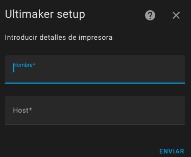
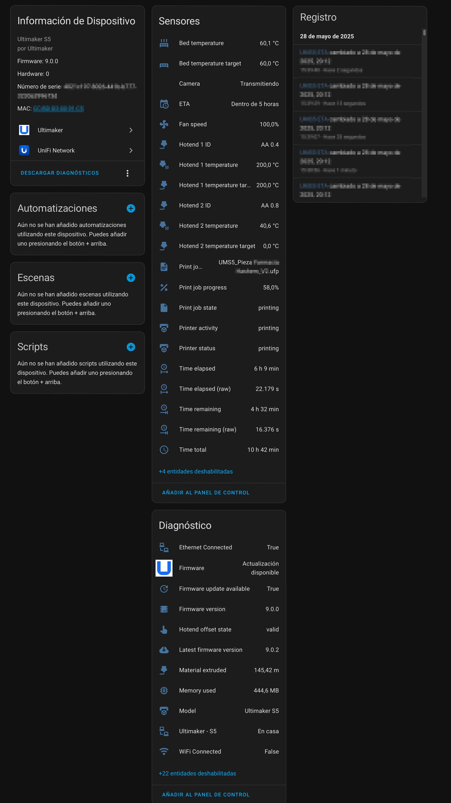
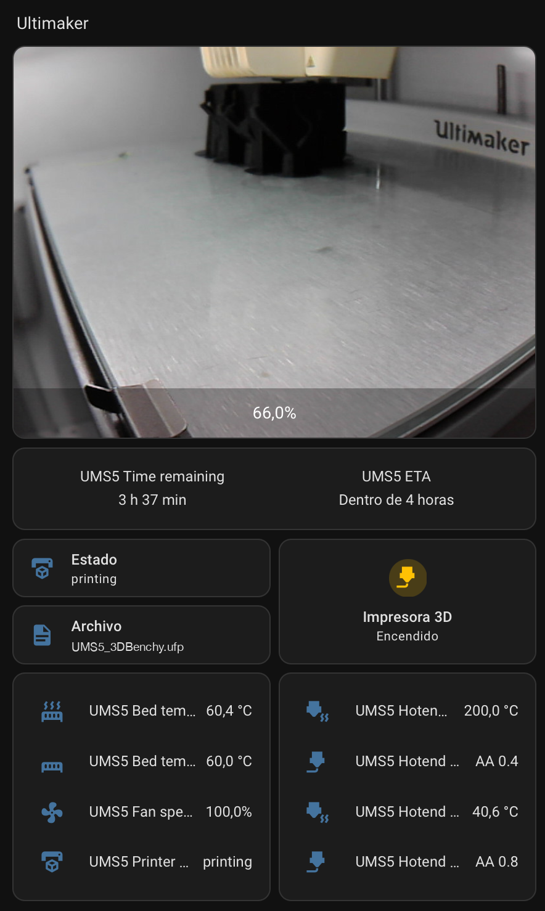

# Home Assistant Integration: Ultimaker

[](https://hacs.xyz/)

Custom integration for monitoring **UltiMaker 3**, **S3**, **S5**, **S7** and **S8** 3D printers from Home Assistant, over your local network and through **UltiMaker Digital Factory**. Provides detailed real-time data, camera stream, firmware updates, and cloud data such as the print queue, faults and material station.

---

## Features

* 🖨️ Print job status, progress, ETA, and remaining time
* 🔥 Extruder and bed temperatures
* 🌡️ Ambient temperature
* ⚙️ System firmware, hardware info, uptime
* 📸 Live camera view and snapshots
* 🔄 Firmware update availability
* 📊 Sensor data with proper device classes and icons
* 🧠 Uses DataUpdateCoordinator for efficient polling
* 📁 Fully supports config flow (UI setup)
* ☁️ **UltiMaker Digital Factory**: add printers from your workspace, including printers Home Assistant cannot reach on your network (S-line, Factor 4/4+, MakerBot and more)
* 🔗 A printer reached both ways shows up as **one device**: live sensors over the LAN, cloud data on top

---

## Installation

### Option 1: HACS (Recommended)

1. Go to **HACS > Integrations**
2. Click **+ Explore & Download Repositories**
3. Search for `Ultimaker` and add it as a custom integration
4. Restart Home Assistant
5. Add the integration from **Settings > Devices & Services**

### Option 2: Manual

1. Copy the `ultimaker/` folder to `custom_components/` in your Home Assistant config
2. Restart Home Assistant
3. Add the integration from **Settings > Devices & Services**

---

## Configuration

No YAML required.

After installation, go to **Settings > Devices & Services**, click **Add Integration**, and select **Ultimaker**. Choose what to add:

* **A printer on the local network**: enter the printer's IP address and a name.
* **Printers from Digital Factory**: paste an API token and tick the printers to import. You can change the list later from the entry's **Configure** button. Adding a printer that is also set up over the LAN merges the two into one device.

### Digital Factory API token

Create the token in Digital Factory under [Settings > API Tokens](https://digitalfactory.ultimaker.com/app/settings/api-token) and copy the **whole** value (it looks like `umapi-…|eu`, including the `|` and the region). Creating a token requires a workspace admin on the Business, Business Plus, Unlimited, Excellence or Campus plan. If the page is missing for you, [upgrade your subscription](https://subscription.ultimaker.com). Sign-in with your UltiMaker account (OAuth) is planned.

Cloud data is refreshed every 60 seconds and is read-only for now. For each imported printer you get: status, print queue (the queued jobs as attributes), last print job result, active faults, firmware update status, maintenance required, Digital Factory connection, per-extruder material, material station slots and the air manager filter. Printers without a LAN connection also get the print job, progress, time remaining and temperatures.



---

## Available Entities

* Ambient Temperature
* Bed Temperature
* Bed Target Temperature
* Extruder 0 Temperature
* Extruder 0 Target Temperature
* ETA
* Firmware Version
* Hardware Revision
* Layer Number
* Material 0 Length Remaining
* Material 0 Type
* Model
* Nozzle Diameter
* Print Duration
* Print Duration Elapsed
* Print Duration Remaining
* Print Job Name
* Printer Status
* Serial Number
* Total Extrusion
* Total Hot Time
* Total Print Time
* Uptime
* Variant
* Camera (Stream & Snapshot)
* Firmware Update Available


---

## Upgrading to 2.0

Version 2.0 identifies every printer by its GUID, so that one printer is one device however it is connected. The first time a printer answers after the upgrade, its existing device and entities are moved over **in place**: entity IDs and history are kept. Back up your Home Assistant before upgrading anyway, as the migration rewrites device and entity identifiers. A printer that is switched off during the upgrade is migrated the next time it is reachable. If two entries point at the same printer, the first keeps the shared identity and the second is left unchanged; remove the duplicate.

## Breaking Changes (1.0)

Version 1.0 was a complete rewrite. It is **not compatible** with earlier versions and introduces breaking changes in:

* Entity unique IDs
* Sensor availability and types
* Data update logic (now using `DataUpdateCoordinator`)
* UI configuration only (no YAML)

Please remove and re-add the integration if you’re updating from a previous version.

---

## Lovelace

Add a Lovelace card to the UI:

Example 1



```yaml
type: grid
cards:
  - type: heading
    heading: UltiMaker
    heading_style: title
  - show_state: true
    show_name: false
    camera_view: auto
    fit_mode: cover
    type: picture-entity
    entity: sensor.ums5_print_job_progress
    camera_image: camera.ums5_camera
    tap_action:
      action: more-info
  - show_name: true
    show_icon: false
    show_state: true
    type: glance
    entities:
      - entity: sensor.ums5_time_remaining
      - entity: sensor.ums5_eta
    state_color: false
  - type: tile
    entity: sensor.ums5_printer_activity
    features_position: bottom
    vertical: false
    name: Estado
    grid_options:
      columns: 6
      rows: 1
  - type: tile
    entity: switch.sonoff_10003b7db7
    features_position: bottom
    vertical: true
    icon_tap_action:
      action: more-info
  - type: tile
    entity: sensor.ums5_print_job_name
    features_position: bottom
    vertical: false
    grid_options:
      columns: 6
      rows: 1
    name: Archivo
  - type: entities
    entities:
      - entity: sensor.ums5_bed_temperature
      - entity: sensor.ums5_bed_temperature_target
      - entity: sensor.ums5_fan_speed
      - entity: sensor.ums5_print_job_state
    grid_options:
      columns: 6
      rows: auto
  - type: entities
    entities:
      - entity: sensor.ums5_hotend_1_temperature
      - entity: sensor.ums5_hotend_1_id
      - entity: sensor.ums5_hotend_2_temperature
      - entity: sensor.ums5_hotend_2_id
    grid_options:
      columns: 6
      rows: auto
```

Example 2

```yaml
type: grid
cards:
  - type: heading
    icon: ""
    heading_style: title
    heading: UltiMaker
  - show_state: false
    show_name: false
    camera_view: auto
    fit_mode: cover
    type: picture-entity
    entity: sensor.ums5_print_job_progress
    camera_image: camera.ums5_camera
    tap_action:
      action: more-info
  - type: markdown
    content: >
      **Hora finalización:**   {{ as_timestamp(states('sensor.ums5_eta')) |
      timestamp_custom('%H:%M', true) }}

      **Tiempo transcurrido:**   {{ states('sensor.ums5_time_elapsed') }} h

      **Tiempo restante:**   {{ states('sensor.ums5_time_remaining') }} h

      **Archivo actual:**   {{ states('sensor.ums5_print_job_name') }}

      **Estado de la impresora:**   {{ states('sensor.ums5_printer_activity') }}
      // {{ states('sensor.ums5_print_job_progress') }} %

      **Hotend 1:**   {{ states('sensor.ums5_hotend_1_temperature') }} °C // {{
      states('sensor.ums5_hotend_1_temperature_target') }} °C // {{
      states('sensor.ums5_hotend_1_id') }}

      **Hotend 2:**   {{ states('sensor.ums5_hotend_2_temperature') }} °C // {{
      states('sensor.ums5_hotend_2_temperature_target') }} °C // {{
      states('sensor.ums5_hotend_2_id') }}

      **Cama caliente:**   {{ states('sensor.ums5_bed_temperature') }} °C
      (objetivo: {{ states('sensor.ums5_bed_temperature_target') }} °C)  

      **Firmware:**   {{ states('sensor.ums5_firmware_version') }} → Última: {{
      states('sensor.ums5_latest_firmware_version') }}
```


## Ultimaker Integration Roadmap for Home Assistant

**v2.0 – Digital Factory (current beta)**
- Digital Factory connection with API token sign-in and a printer import list
- One device per printer, merged across LAN and cloud
- Cloud data: print queue, faults, material station, air manager, firmware status
- Test suite (`pytest`) and CI, GUID-based identity migration

**Next: v2.1 – Controls and OAuth**
- Pause, resume and abort buttons, queue actions, identify, clear build plate (over Digital Factory)
- Cloud camera snapshot
- Sign in with your UltiMaker account (OAuth)
- Discover LAN printers from a cloud connection

---

**v1.0 – Stable Version**
- Functional sensors: temperature, progress, time, firmware, etc.
- Proper device grouping
- Configuration via `config_flow`
- Basic webhook support (`camera.snapshot`)
- Implemented localization with language files `en.json` and `es.json`
- Metadata defined (`iot_class`, `integration_type`, etc.)
- Clean `device_class`, `entity_category`, `state_class`
- Advanced sensors: `print_count`, `hours_on`, `filament_used`

---

**v1.1 – Cleanup, Structure, and Basic Checks**

Improve structure, ensure compliance with HA standards, and add resiliency

- [ ] Complete translations (ensure no hardcoded strings)
- [ ] Finalize `manifest.json` cleanup (validate all fields)
- [ ] Add full translation support:
  - [ ] Implement `strings.json` to define UI labels and errors in the config flow
  - [ ] Add `translations/en.json` and `translations/es.json` for multilingual support
  - [ ] Ensure all `translation_key` values in `config_flow.py` are declared in `strings.json`- [ ] Add error handling if the printer is offline/unreachable
- [ ] Ensure consistent `unique_id` generation
- [ ] Add `extra_state_attributes` to relevant sensors
- [ ] Group entities logically by domain or purpose
- [ ] Ensure full `async_unload_entry` support
- [ ] Input validation in `config_flow` (e.g., valid IP format)
- [ ] Add basic schema validation and unit tests

---

**v1.2 – Automatic Discovery and Detection**

Make setup easier and seamless via network discovery

- [ ] Support `zeroconf`/`mdns` auto-discovery
- [ ] Adjust `config_flow.py` to accept network detections
- [ ] Detect model (UMS5, S3...) and customize sensors accordingly
- [ ] Check for active HTTP port during setup

---

**v1.3 – Controls with Authentication**

Enable active interaction with the printer via Home Assistant

- [ ] Implement HTTP Digest authentication (`/auth/request`, `/auth/check`)
- [ ] Add control buttons:
  - [ ] Pause print
  - [ ] Resume print
  - [ ] Cancel print
  - [ ] Preheat bed and hotends
- [ ] Verify authentication with `/auth/verify`
- [ ] Store `id` and `key` securely in `config_entry.options`
- [ ] Handle auth errors and retries gracefully

---

**v1.4 – Quality, Testing, and Core Readiness**

Final QA and compatibility for Home Assistant Core

- [ ] Add unit tests with `pytest`, `aiohttp`, mocking printer responses
- [ ] Include `analytics.json` (opt-in telemetry)
- [ ] GitHub CI for linting and automated testing
- [ ] Ensure documentation is complete (`README.md`, usage examples)
- [ ] Optional: prepare and submit PR to Home Assistant Core

---


## Credits

This integration was inspired by the original work of [jellespijker](https://github.com/jellespijker) and later expanded by [alnavasa](https://github.com/alnavasa).


## License

MIT License. Not affiliated with Ultimaker BV.
